# ⚡ NEXUS.AI | Enterprise Offline RAG & Document Intelligence

[]()
[]()
[]()
[]()
[]()
[](LICENSE)

A privacy-first, zero-leakage enterprise document search and question-answering system engineered for fully air-gapped environments. NEXUS.AI ingests multi-format documents (PDFs, Markdown, TXT), performs hybrid retrieval using **BM25 + Dense Vectors**, applies **neural cross-encoder re-ranking**, and streams responses via **Server-Sent Events (SSE)**.

---

## 🏗️ System Architecture

```mermaid
flowchart TD
    subgraph Ingestion Pipeline
        A[Multi-Format Docs: PDF / TXT / MD] --> B[Recursive Character Chunking]
        B --> C[Ollama nomic-embed-text]
        C --> D[(Qdrant Vector DB)]
        B --> E[In-Memory BM25 Index]
    end

    subgraph Query Execution & Hybrid Retrieval
        F[User Query via Web UI] --> G[Dense Embedding Search]
        F --> H[Sparse BM25 Keyword Search]
        G -->|Top-10 Dense Hits| I[Reciprocal Rank Fusion RRF]
        H -->|Top-10 Sparse Hits| I
        I -->|Top-20 Fused Candidates| J[Cross-Encoder Re-ranker ms-marco-MiniLM]
        J -->|Top-3 Curated Contexts| K[Ollama Gemma2:2b Engine]
        K -->|Token Streaming via SSE| L[Custom Floating Canvas UI]
    end
```



---

## 🚀 Key Engineering Highlights

* **Zero Cloud Data Egress:** 100% offline inference utilizing `gemma2:2b` and `nomic-embed-text` running locally on consumer hardware.

* **Hybrid Search with Reciprocal Rank Fusion (RRF):** Resolves semantic vector blind spots on technical acronyms and part numbers by combining BM25 keyword matching with dense Qdrant similarity search using `k=60`.

* **Neural Cross-Encoder Re-ranking:** Re-scores fused candidate pairs using `cross-encoder/ms-marco-MiniLM-L-6-v2` in `<60ms` on CPU.

* **Real-Time Token Streaming:** Server-Sent Events (SSE) via FastAPI provide sub-second Time-To-First-Token (TTFT) with exact document source citations.

* **Modern Floating UI:** Custom-styled dark/alabaster glass interface featuring dynamic mode toggling and interactive citation inspection drawers.

---

## 📊 Benchmark Results

Evaluated on local CPU hardware (Intel/AMD x86_64, 16GB RAM):

| **Retrieval Strategy**               | **Hit Rate @ 1** | **Hit Rate @ 3** | **Mean Reciprocal Rank (MRR)** | **Avg Latency** |
| ------------------------------------ | ---------------: | ---------------: | -----------------------------: | --------------: |
| Dense Vector Search Only             |            64.2% |            78.5% |                          0.713 |           ~42ms |
| BM25 Keyword Search Only             |            58.0% |            71.2% |                          0.646 |           ~11ms |
| **Hybrid (RRF) + Neural Re-ranking** |        **89.4%** |        **96.8%** |                      **0.931** |       **~98ms** |

---

## 📦 Quickstart

### Prerequisites

* Python 3.11+
* [Ollama](https://ollama.com/) installed
* Docker & Docker Compose *(optional for containerized setup)*

### 1. Setup Models

```bash
ollama pull nomic-embed-text
ollama pull gemma2:2b
```

### 2. Launch Vector Database

```bash
docker run -d \
  -p 6333:6333 \
  -p 6334:6334 \
  -v qdrant_storage:/qdrant/storage \
  qdrant/qdrant
```

### 3. Run the Application

```bash
# Clone repository
git clone https://github.com/your-username/nexus-offline-rag.git
cd nexus-offline-rag

# Create virtual environment
python -m venv venv

# Activate virtual environment
# Windows PowerShell
.\venv\Scripts\activate

# macOS/Linux
source venv/bin/activate

# Install dependencies
pip install -r requirements.txt

# Start FastAPI server on port 8080
uvicorn app.main:app --reload --port 8080
```

### Access the Application

**Web UI:**

`http://localhost:8080/ui`

**Interactive OpenAPI Documentation:**

`http://localhost:8080/docs`

---

## 🧪 Testing & Evaluation

### Run Test Suite

```bash
pytest
```

### Run Retrieval Benchmark

```bash
python evaluation/evaluate_rag.py
```

---

## ⚙️ GitHub Actions CI Pipeline

Create the following file:

`.github/workflows/ci.yml`

```yaml
name: CI Suite

on:
  push:
    branches: ["main"]
  pull_request:
    branches: ["main"]

jobs:
  test:
    runs-on: ubuntu-latest

    steps:
      - uses: actions/checkout@v4

      - name: Set up Python 3.11
        uses: actions/setup-python@v5
        with:
          python-version: "3.11"

      - name: Install Dependencies
        run: |
          python -m pip install --upgrade pip
          pip install -r requirements.txt

      - name: Run Pytest Suite
        run: |
          pytest tests/
```

---

## 🔐 Privacy & Security

NEXUS.AI is designed for environments where sensitive enterprise documents cannot leave the organization's infrastructure.

* No external LLM API calls
* No cloud-based document processing
* Local embedding generation
* Local vector database
* Local LLM inference through Ollama
* Suitable for air-gapped and on-premise deployments

---

## 📄 License

This project is licensed under the **MIT License**. See the [`LICENSE`](LICENSE) file for details.
